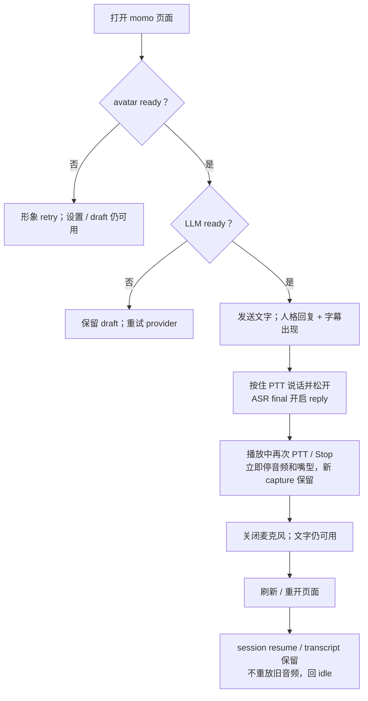

# Web 交互闭环

> 打开 momo，她就在页面里。你可以打字、说话、随时插话，也能接着上次的话题聊。
>
> Web 是交互主迭代面（ADR-011）：所有相处体验先在这里定稿，之后由 Tauri 桌面壳原样复刻。

## 交付范围

- `momod` + Web UI：单实例运行、自托管页面、多浏览器标签按单 session 绑定；桌面窗口/置顶/穿透属后置 Tauri 壳范围（[desktop.md](../01-architecture/desktop.md)）。
- TS Pixi 7 + Live2D：真实模型加载（默认 Hiyori，可替换）、可用 idle/gaze/tap、subtitle/chat overlay、实际 AudioWorklet 播放驱动 lipsync。
- persona card → system prompt 的人格化回复；emotion tag 气泡与字幕同步。
- 文字、PTT、用户 opt-in 连续 VAD；麦克风/ASR 失败时释放 mic 并保留文字输入。
- Stop/barge-in：同步停本地音频与嘴型，actor 并行取消上游，再按 playback ACK settlement 结算；新 capture 独立保留。
- Rust tokio+axum session actor 与 `TurnCoordinator`；LLM 走用户配置的 OpenAI-compatible SSE 端点；ASR/TTS 走用户配置的 provider 接口（每类单槽位，ADR-028）。
- 本地 transcript + persona；历史查看、改标题、correction、删除、导出、新对话。
- momo-ws 统一传递输入、状态、字幕与音频。

## readiness

avatar 与 backend 独立准备。LLM ready 即可文字 reply；ASR 缺失只禁用语音输入，TTS 缺失则 text-only。LLM 缺失时保留 avatar、draft 与设置，但不生成 AI reply。退出只终止 owned child process，不关闭 attached provider。

## 验收旅程

## 验收

- [ ] 刷新/重开在 TTL 内恢复 session；字幕气泡与 ASR 草稿正确渲染、上限可控。
- [ ] 文字流程覆盖 IME、空输入、4000 字符、重复 id、busy turn 与 Stop。
- [ ] PTT 覆盖 press/release、无非静音 segment、取消和失焦；VAD 失败释放 mic 并提供重新启用。
- [ ] `Speaking` 由实际 `playback.started` 触发；嘴型来自实际播放，Stop 立即归零。
- [ ] interruption 不等 ACK 才 cancel；settlement deadline 后 unknown 保持 unconfirmed。
- [ ] TTS/LLM/ASR/设备失败只做对应能力的 UI 呈现降级（app 不编排多 provider 容灾）；已经听过的内容不重播。
- [ ] history correction 不改 audit；active delete/new-chat 先 cancel；export 事务失败保留数据。
- [ ] 断线、sleep/wake、重启均无旧音频 replay；draft/transcript 按规范保留。
- [ ] 用户可配置 LLM/ASR/TTS endpoint 与替换 Live2D 模型，默认开箱即 Hiyori。
