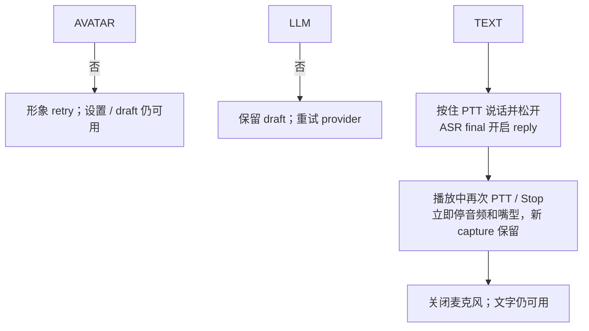

## 交付范围

- 文字、PTT、用户 opt-in 连续 VAD；麦克风/ASR 失败时释放 mic 并保留文字输入。
- Stop/barge-in：同步停本地音频与嘴型，actor 并行取消上游，再按 playback ACK settlement 结算；新 capture 独立保留。
- 本地 transcript + persona；历史查看、改标题、correction、删除、导出、新对话。
- momo-ws 统一传递输入、状态、字幕与音频。

## readiness

- [ ] 文字流程覆盖 IME、空输入、4000 字符、重复 id、busy turn 与 Stop。
- [ ] PTT 覆盖 press/release、无非静音 segment、取消和失焦；VAD 失败释放 mic 并提供重新启用。
- [ ] `Speaking` 由实际 `playback.started` 触发；嘴型来自实际播放，Stop 立即归零。
- [ ] interruption 不等 ACK 才 cancel；settlement deadline 后 unknown 保持 unconfirmed。
- [ ] history correction 不改 audit；active delete/new-chat 先 cancel；export 事务失败保留数据。
- [ ] 断线、sleep/wake、重启均无旧音频 replay；draft/transcript 按规范保留。
