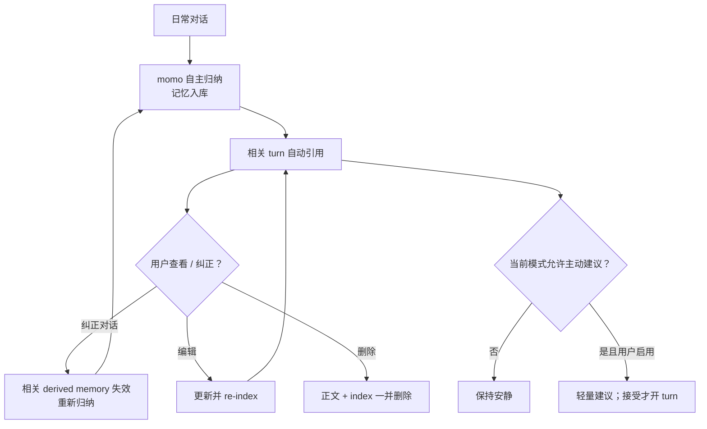

# 像人深化：自管理记忆与相处模式

> 「像人」的核心是她记得。momo 自主管理长期记忆——自己归纳、引用、遗忘，随相处自进化；用户保留完整的查看、纠正与删除权。

## 范围

- **自管理长期记忆（ADR-014）**：momo 从对话中自主归纳记忆入库、整理与引用——不需要逐条人工确认，记忆是她的能力而非用户的管理负担。
- **用户监督面**：所有记忆可查看正文与来源、可编辑、可检索、可删除；删除同时移除正文和 vector index。correction 使相关 derived memory 失效后重新归纳。
- quiet / focus / companion 三种模式，与 mic mute 分离。
- proactive suggestion 默认关闭；仅用户启用，且不在 focus、通话、listening、quiet hours 触发；dismiss 后冷却。
- 获授权的声线个性化：zero-shot → frozen gate → 可选 SFT → 同一 gate → promote/rollback。
- persona card/context/routine 可被用户纠正；微调只是可选后续工具。

## 自管理记忆闭环

详细操作分支见 [workflows.md](../01-architecture/workflows.md)。

## 验收

- [ ] 任何 memory 都能追溯来源；自动归纳的内容对用户可见可审计。
- [ ] correction 使相关 derived memory 失效；重新归纳不再依赖被纠正的旧结论。
- [ ] 编辑后检索使用新内容；删除后正文与索引均不可检索。
- [ ] quiet/focus/companion 不会隐式改变麦克风设置，mute 也不会隐式改变 companion mode。
- [ ] proactive 默认关闭；所有阻断条件和 dismiss 冷却可观察。
- [ ] 声线只使用有授权记录的材料，promotion 与 rollback 复用统一 frozen evaluation gate（训练侧细则随语音管线迁往 momo-infra）。
