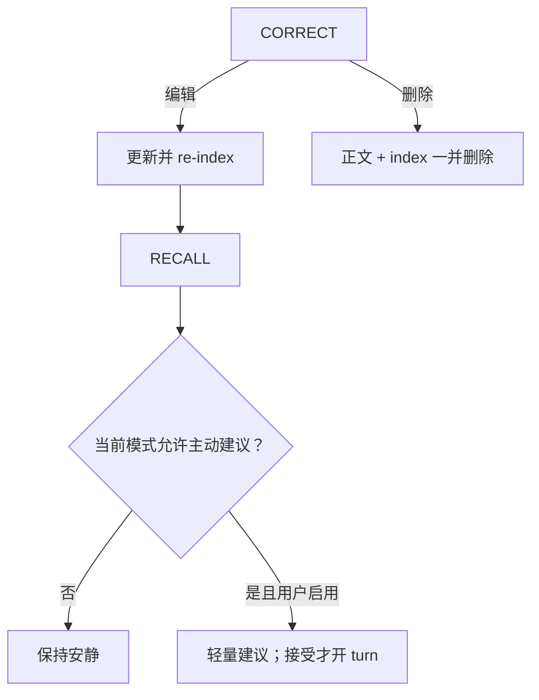

## 范围

- quiet / focus / companion 三种模式，与 mic mute 分离。
- proactive suggestion 默认关闭；仅用户启用，且不在 focus、通话、listening、quiet hours 触发；dismiss 后冷却。
- 获授权的声线个性化：zero-shot → frozen gate → 可选 SFT → 同一 gate → promote/rollback。
- persona card/context/routine 可被用户纠正；微调只是可选后续工具。

详细操作分支见 [workflows.md](../01-architecture/workflows.md)。

## 验收

- [ ] 编辑后检索使用新内容；删除后正文与索引均不可检索。
- [ ] quiet/focus/companion 不会隐式改变麦克风设置，mute 也不会隐式改变 companion mode。
- [ ] proactive 默认关闭；所有阻断条件和 dismiss 冷却可观察。
