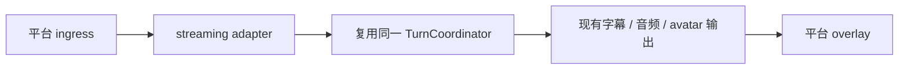

# 直播扩展

> 直播是保留的长期方向（当前不交付）：通过独立输入与输出适配器接入，共用 companion 的对话和呈现能力，不把直播业务写进运行时。

## 扩展方向

adapter 负责平台接入、授权、过滤与 overlay，不承载 turn、persona、memory 或推理业务。公开使用需要分别确认 Live2D 模型、Runtime Core、声音与平台许可。

相关协作方式见 [受控扩展](./dialogue.md)。
