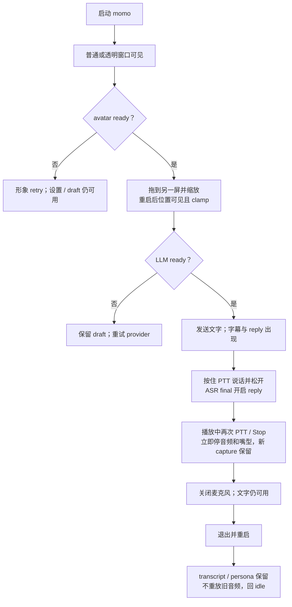

# P0：桌面 MVP

> 打开 momo，她就在桌面上。你可以打字、说话、随时插话，也能拖动、收起她，再接着上次的话题聊。

## 交付范围

- `app/src-tauri`：Tauri 2 单实例、透明 pet 窗口、system menu、drag/scale、always-on-top；click-through 只在可靠恢复入口存在时启用。
- TS Pixi 7 + Live2D：真实模型加载、可用 idle/gaze/tap/drag、subtitle/chat overlay、实际 AudioWorklet 播放驱动 lipsync。
- 文字、PTT、用户 opt-in 连续 VAD；麦克风/ASR 失败时释放 mic 并保留文字输入。
- Stop/barge-in：同步停本地音频与嘴型，actor 并行取消上游，再按 playback ACK settlement 结算；新 capture 独立保留。
- Rust tokio+axum session actor 与 `TurnCoordinator`；Python ASR/TTS/Embedding adapters；OpenAI-compatible SSE LLM。
- 本地 transcript + persona；历史查看、改标题、correction、删除、导出、新对话。
- momo-ws 统一传递输入、状态、字幕与音频。

## readiness

shell/settings、avatar 与 backend 独立准备。LLM ready 即可文字 reply；ASR 缺失只禁用语音输入，TTS 缺失则 text-only。LLM 缺失时保留 avatar、draft 与设置，但不生成 AI reply。退出只终止 owned child process，不关闭 attached provider。

## MVP 接受旅程

## P0 验收

- [ ] 单实例启动；透明/menu 不支持时普通可见窗口可操作。
- [ ] pet 可拖拽、点击、缩放、跨 DPI/显示器恢复；拔屏后仍在可见区域。
- [ ] menu 不可用时 click-through 已禁用；退出只停止 owned child。
- [ ] 文字流程覆盖 IME、空输入、4000 字符、重复 id、busy turn 与 Stop。
- [ ] PTT 覆盖 press/release、无非静音 segment、取消和失焦；VAD 失败释放 mic 并提供重新启用。
- [ ] `Speaking` 由实际 `playback.started` 触发；嘴型来自实际播放，Stop 立即归零。
- [ ] interruption 不等 ACK 才 cancel；settlement deadline 后 unknown 保持 unconfirmed。
- [ ] TTS/LLM/ASR/设备失败只降级对应能力，已经听过的内容不重播。
- [ ] history correction 不改 audit；active delete/new-chat 先 cancel；export 事务失败保留数据。
- [ ] 断线、sleep/wake、重启均无旧音频 replay；draft/transcript 按规范保留。
