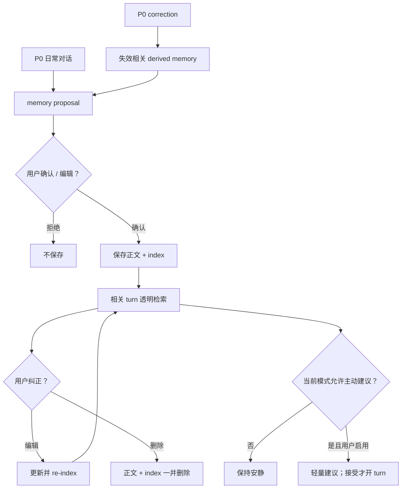

# P1：熟悉的 companion

> P1 在 P0 的历史与 correction 基础上增加用户可控的熟悉感；记忆、模式、主动行为与声线都可解释、可编辑、可关闭。

## 范围

- correction 只作用于未来 context；相关 derived memory 失效，并在重新提议、用户确认后更新。
- memory proposal：先展示来源与用途，确认后才保存；用户可编辑、检索、删除，删除同时移除正文和 vector index。
- quiet / focus / companion 三种模式，与 mic mute 分离。
- proactive suggestion 默认关闭；仅用户启用，且不在 focus、通话、listening、quiet hours 触发；dismiss 后冷却。
- 获授权的声线个性化：zero-shot → frozen gate → 可选 SFT → 同一 gate → promote/rollback。
- persona card/context/routine 可被用户纠正；微调只是可选后续工具。

## 熟悉感闭环

详细操作分支见 [workflows.md](../01-architecture/workflows.md)。

## 验收

- [ ] 任何 memory 都能追溯来源，并在保存前得到确认。
- [ ] correction 使相关 derived memory 失效；重新保存仍需用户确认。
- [ ] 编辑后检索使用新内容；删除后正文与索引均不可检索。
- [ ] quiet/focus/companion 不会隐式改变麦克风设置，mute 也不会隐式改变 companion mode。
- [ ] proactive 默认关闭；所有阻断条件和 dismiss 冷却可观察。
- [ ] 声线只使用有授权记录的材料，promotion 与 rollback 复用 [voice-clone.md](../04-tracks/voice-clone.md) frozen gate。
