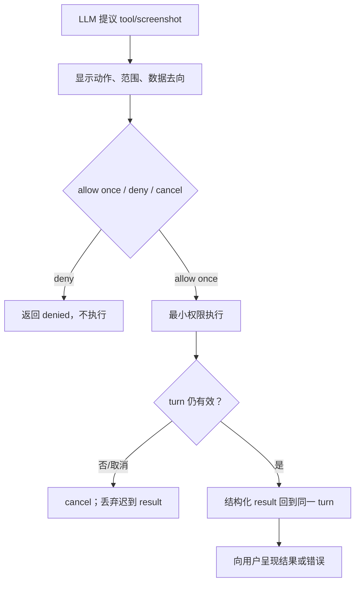
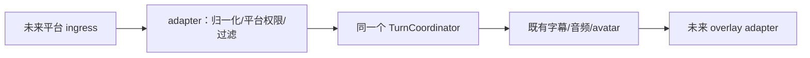

# P2：受控扩展

> P2 增加工具、截图与运维/训练界面；每个越出对话边界的动作都必须得到用户授权。streaming adapter 作为独立扩展方向，共用既有回合核心。

## 工具权限路径

## infra 与训练 UI

- 配置只在 draft 中编辑：validate → test → atomic apply；失败恢复旧配置。密钥在独立 secret store 中设置/清除，UI 不回显。
- 模型：fetch → checksum → probe → activate；失败保持旧版本；保留可回滚版本。
- 训练 job 使用 `queued / preparing / running / canceling / canceled / recovering / failed / succeeded / promoted`。SSH 断线先按 remote job id 与 process identity 进入 `recovering`，不能只因连接丢失判 `failed`，也不能重复 launch。

训练生命周期、取消、恢复与 promotion 集中在 [`momo-infra.md` 的训练 lifecycle](../02-repos/momo-infra.md#训练-lifecycle-与恢复)，沿用既有训练配置与评分门槛。

## future streaming adapter

adapter 不拥有 turn、persona、memory、推理或 runtime 业务。

## 验收

- [ ] deny 不产生外部副作用；执行中 cancel 会丢弃迟到结果。
- [ ] screenshot 每次说明采集范围，不因曾允许一次而永久授权。
- [ ] 配置 test 失败不改变 active 配置，secret 不进入日志或静态网站。
- [ ] 模型 checksum/readiness 失败不替换 active 版本，rollback 可用。
- [ ] 本地/SSH job 断线后可从 job store/checkpoint 判断继续、失败或取消；状态不会假成功。
- [ ] streaming adapter 保持独立，只负责平台接入与输出 overlay。
