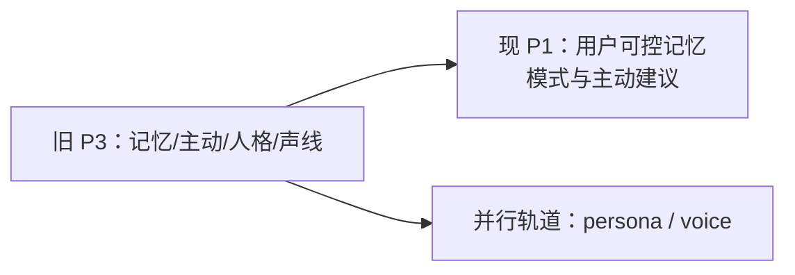

# 兼容页：旧 P3「灵魂」

> 旧 phase 编号已退休。本路径保留以免旧链接失效，不再定义独立里程碑。

当前权威范围：

- [P1 companion](./p1-stage.md)
- [persona 轨道](../04-tracks/persona.md)
- [声线轨道](../04-tracks/voice-clone.md)
- [操作路径图谱](../01-architecture/workflows.md)

旧页中的 character card、prompt、采样、评测和训练细节已由轨道文档继续承载，迁移不改变其既有内容或门槛。
