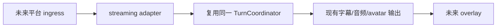

# 兼容页：旧 P5「直播」

> 旧 phase 编号已退休。本路径保留以免旧链接失效。streaming adapter 是以后可能的扩展，不是 P0/P1/P2 承诺。

约束：adapter 只做平台接入、授权、过滤与 overlay，不承载 turn、persona、memory 或推理业务。任何公开使用还需单独确认 Live2D 模型、Runtime Core、声音与平台许可；当前不做 go-live 承诺。

当前相关设计见 [P2 受控扩展](./p2-dialogue.md)。
