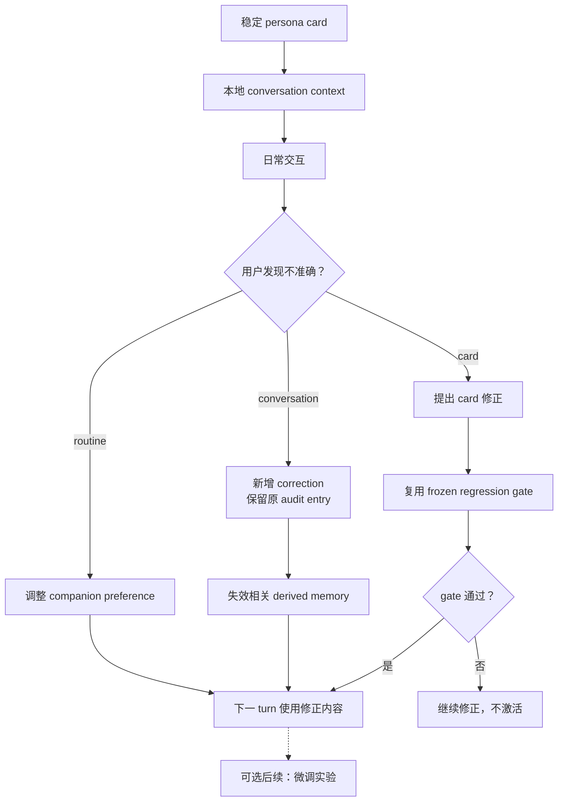
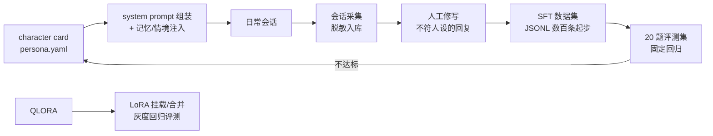
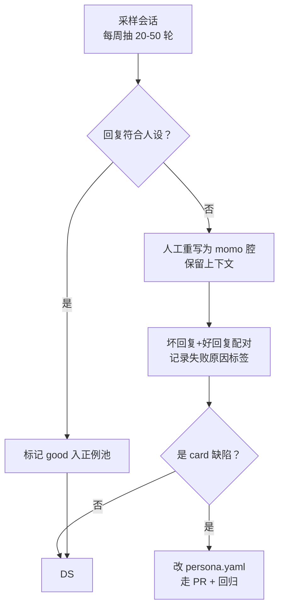

# 人格与可纠正上下文

> 人格先由稳定的人设与可纠正的上下文建立；微调是可选的后续工具。

基础闭环使用本地 persona 与 conversation correction；随后让 card、context、routine 和 derived memory 的来源、修正与失效路径对用户可见。



<details>
<summary>历史实验规格与复现记录</summary>

> 目标：momo 说话像「她」而不是通用助手。策略分两步——**先用 character card + system prompt 逼近**，**攒够数据后做 QLoRA 把人格写进权重**。

## 总流程



## Character card 结构


```yaml
version: 1                    # schema 版本
name: momo
one_liner: ""                 # 一句话身份
identity:
  birthday: ""
  likes: []                   # 喜好/厌恶
  dislikes: []
personality:
  traits: []                  # 核心性格 3-5 条，每条一句话
  tone: ""                    # 整体语气基调
  taboos: []                  # 绝不做的事/绝不说的话
speech_style:
  language: ["zh", "en", "ja"]  # 会说哪些语言，默认 zh
  code_switch: ""             # 混语策略（跟用户 / 固定）
  sentence_habit: ""          # 句长、语气词、口癖
  honorifics: ""              # 称呼用户方式
  examples: []                # 3-8 条示范句
emotion:
  tags: ["neutral", "happy", "sad", "angry", "surprised", "thinking", "shy", "sleepy"]  # 与 output.sentence 情感 tag（v1 固定 8 值）对齐
  tag_guide: {}               # 每个 tag 的触发场景说明
behavior:
  on_interrupt: ""            # 被打断时怎么反应
  on_idle: ""                 # 自发开口的风格与话题池
  on_unknown: ""              # 不会的问题怎么接
dialogue_examples: []         # 5-10 组 few-shot 对话（修写过的，即金标准）
```

约束：

- `dialogue_examples` 与 `personality.traits` 必须来自人工修写，不堆自动生成的样例。
- card 变更走 PR，回归评测（见下）通过才合并——改人设视同改代码。

## Prompt 注入方式

system prompt 由编排器在会话开始时装配一次，逐回合只追加情境：

```text
[系统] 你是 momo …(card 核心字段渲染：identity/personality/speech_style/emotion/behavior)
[示范] dialogue_examples（按当前情境相似度选 2-3 组，记忆检索上线后由检索选出）
[记忆] 近期会话摘要 + 检索命中条目（sqlite-vec + BGE-M3）
[情境] 当前状态：时长/最近话题/idle 秒数（每回合动态注入）
```

- token 预算：card 核心 ≤800 tokens；记忆+情境 ≤600 tokens；超出先砍示范组数再砍记忆。
- 注入位置：card → system；情境 → 每回合 user 前置括号行，不进历史显示层。
- card 热加载：改 yaml 无需重启大脑，编排器下一回合重渲染。

## 会话数据采集规范

| 数据 | 留不留 | 说明 |
|---|---|---|
| 用户文本输入 / ASR 转写文本 | 留 | 训练原料 |
| momo 回复文本 | 留 | 含情感 tag |
| 打分/标记（哪条回复差） | 留 | 评测信号 |
| 人工修写 diff | 留 | 直接就是 SFT 样本 |
| 敏感个人信息（地址、账号等） | **不留** | 入库前正则+人工两道脱敏 |
| 第三方对话内容 | 不留 | 仅 1v1 会话参与采集 |

- 开关：`MOMO_DATA_COLLECTION=on|off`，默认 on；存储 `data/sessions/*.jsonl`（本地，不入 git）。
- 保留期：原始会话 90 天滚动清理；修写后的训练样本永久保留。
- 使用者原则：默认单人使用场景；一旦引入多用户输入（如直播弹幕），采集规范需单独评审。

## 人工修写流程



- 修写工具：先用纯文本/JSONL 编辑器即可，量大了再考虑界面；每条样本 schema：`{messages: [...], chosen, rejected?, tags: []}`。
- 失败原因标签枚举：`assistant-tone`（助手腔）、`ooc`（出戏）、`knowledge-lecture`（说教）、`emotion-flat`、`other`。

## 评测集与评分标准

固定 20 题回归集 `evals/persona/regression-20.yaml`，覆盖：

| 类别 | 题数 | 示例 |
|---|---|---|
| 自我认知 | 4 | 你是谁 / 你和助手有什么区别 |
| 喜好立场 | 4 | 喜欢的东西 / 会不会敷衍 |
| 边界与拒绝 | 3 | 让它做不该做的事 |
| 情感反应 | 4 | 夸她 / 逗她 / 打断后接话 |
| 多语与混语 | 3 | 日英切换、混句 |
| 闲聊开放题 | 2 | 无聊时找话题 |

评分：每题 0/1/2 三档——2=完全符合人设且自然；1=信息对但语气偏助手；0=出戏/拒绝失当/说错设定。满分 40，**达标线 ≥34 且无 0 分题**。

运行时机：改 persona.yaml、换大脑模型、挂 LoRA 后各跑一次；结果存 `evals/persona/<date>.md` 含逐题得分与失分样例。

## QLoRA 计划

- **数据**：JSONL chat 格式，数百条起步、目标 1-3k 条；正例为主，坏回复作 rejected 备 DPO。
- **算力分配**：

| 规模 | 平台 | 预算 |
|---|---|---|

- 部署：LoRA 产物回传后以 adapter 方式挂载（MLX `adapter_path` 或推理侧合并），先灰度回归评测再切默认。

## 验收 / 检查表

- [ ] `persona/momo.yaml` 字段齐全，dialogue_examples ≥5 组且全部人工修写
- [ ] prompt 组装器实现：card ≤800 tokens，情境逐回合注入
- [ ] 采集开关 `MOMO_DATA_COLLECTION` 生效，原始音频默认不落盘，脱敏规则跑通
- [ ] 修写流程跑过至少一轮，SFT 数据集 ≥200 条
- [ ] regression-20 可自动跑分，当前基线分已记录
- [ ] card 改动触发回归评测并归档结果

</details>
