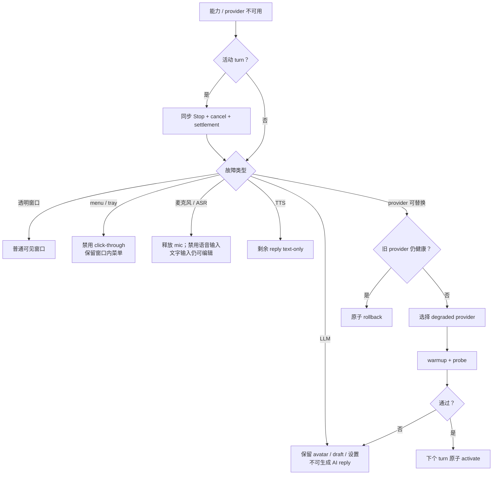

# 当前降级与恢复手册

> provider 或平台能力不可用时保留普通可见窗口、avatar、draft、设置和本地 transcript；LLM ready 时才提供 AI 文字 reply。

## 触发

- provider readiness/probe 失败或活动连接断开；
- 透明窗口、Wayland、全局快捷键、system menu 或麦克风能力不可用；
- normal profile 所需机器不可达；
- 用户主动选择更轻的本地模式。

## 决策路径

## 恢复

候选能力恢复后仍走 warmup/probe；成功前不替换当前健康路径。窗口恢复透明模式前转换坐标并 clamp。session 重连只取 snapshot，不播放断线前音频。退出/切换只停止 owned child，attached provider 不受影响。

## 检查

- [ ] 失败切换不会破坏 active 配置。
- [ ] menu 不可用时 click-through 已禁用。
- [ ] LLM 不可用时没有伪装成可工作的 text fallback。
- [ ] 切换前活动 turn 得到显式 cancel。
- [ ] 恢复后第一轮没有 stale stream 或旧音频。
