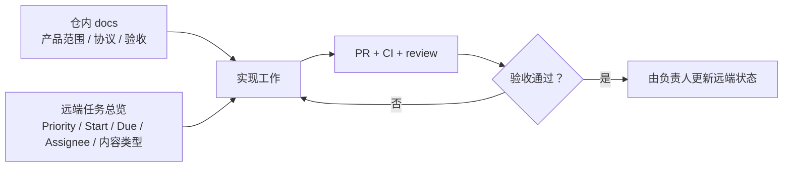

# GitHub Project 管理

> momo 使用单一 monorepo；远端任务状态以 GitHub Project 实际内容为准。

## 单视图策略

Project 保持一个任务总览视图，使用以下管理字段：

| 字段 | 约定 |
|---|---|
| Priority | `P0` 当前闭环 / `P1` 近阶段 / `P2` 扩展；不再增加产品优先级 |
| Start / Due | 已排期任务的开始与截止日期 |
| Assignee | 明确工作所有者 |
| Repository | 当前 monorepo |

不在文档中复制或推断实际 card count、日期与状态。

## 变更流程

1. 先修改 canonical 文档与引用。
2. 实现 PR 指向对应设计和行为验收。
3. CI/review/人工体验通过后，由有权限的负责人更新远端 Project。
