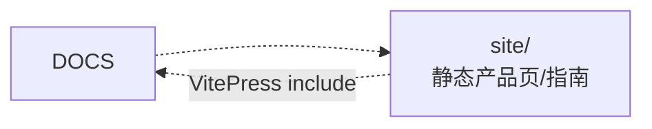

# momo 设计文档

**让桌面多一个，懂得回应的存在。**

## 阅读顺序

1. [产品定义](./00-context/product.md)
3. [总体架构](./01-architecture/system.md)
4. [桌面宿主](./01-architecture/desktop.md)
5. [运行时](./01-architecture/runtime.md)
7. [操作路径图谱](./01-architecture/workflows.md)
8. [模块边界](./01-architecture/boundaries.md)

## 目录

| 目录 | 内容 |
|---|---|
| `01-architecture/` | 系统、桌面、运行时、协议、操作路径、边界、配置 |

## 设计不变量

- `TurnCoordinator` 独占 turn；persona/连接、turn、animation 三套时钟独立。
- Stop 立即停本地播放与嘴型，同时并行取消上游；不等 ACK 才 cancel。
- `Speaking` 由实际 `playback.started` 触发；旧 stream 不得进入新 turn。
- infra 在 turn 数据路径外；静态网站不访问本地 API、密钥或麦克风。
- 上游库、Runtime Core、模型与素材各自核验许可；应用许可证不自动覆盖它们。

## 文档规则

- 使用小而聚焦的 Mermaid 图；用户操作写清 entry、decision、effect、terminal/retry/cancel。
