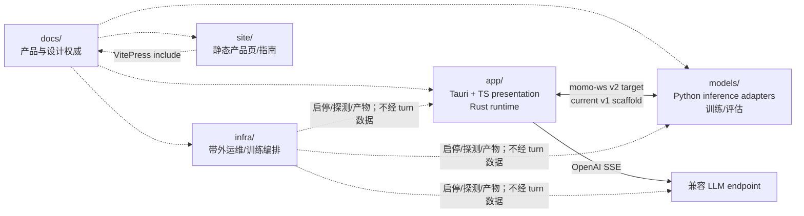

# momo 设计文档

**让桌面多一个，懂得回应的存在。**

momo 是本地优先的 AI 桌宠：有形象，能听你说话，也能安静陪着你。这里是 monorepo 的设计权威；实现与文档不一致时，先修正文档与决策，再协调实现。

## 当前实现边界

目标产品是 P0 完整桌面 companion，协议目标为 `momo-ws v2`；当前代码仍只有 v1 handshake/scaffold，`app/src-tauri` 也是规划目录。文档中的流程是精确设计规范，不代表功能已经实现。

## Monorepo 地图

## 阅读顺序

1. [产品定义](./00-context/product.md)
2. [P0/P1/P2 路线图](./00-context/roadmap.md)
3. [总体架构](./01-architecture/system.md)
4. [桌面宿主](./01-architecture/desktop.md)
5. [运行时](./01-architecture/runtime.md)
6. [协议 v2 目标](./01-architecture/protocol.md)
7. [操作路径图谱](./01-architecture/workflows.md)
8. [模块边界](./01-architecture/boundaries.md)
9. [配置](./01-architecture/config.md)

## 目录

| 目录 | 内容 |
|---|---|
| `00-context/` | 产品、路线、研究、ADR |
| `01-architecture/` | 系统、桌面、运行时、协议、操作路径、边界、配置 |
| `02-repos/` | monorepo 各模块实现边界（旧文件名保留兼容） |
| `03-phases/` | P0 desktop MVP、P1 companion、P2 extensibility；旧 P3/P4/P5 为兼容页 |
| `04-tracks/` | persona 与授权声线轨道；既有 prompt/评分/训练门槛保持 |
| `05-ops/` | 部署、降级、模型获取、借用机器纪律 |
| `06-management/` | GitHub Project 关系；不代表远端状态变更 |

## 设计不变量

- 产品支柱：**在场 / 接话 / 熟悉**；不是 chatbot dashboard，也不以 streaming 为当前目标。
- `TurnCoordinator` 独占 turn；persona/连接、turn、animation 三套时钟独立。
- Stop 立即停本地播放与嘴型，同时并行取消上游；不等 ACK 才 cancel。
- `Speaking` 由实际 `playback.started` 触发；旧 stream 不得进入新 turn。
- infra 在 turn 数据路径外；静态网站不访问本地 API、密钥或麦克风。
- 未经平台实测的平台能力使用普通可见窗口与系统菜单 fallback。
- 上游库、Runtime Core、模型与素材各自核验许可；应用许可证不自动覆盖它们。

## 文档规则

- 使用小而聚焦的 Mermaid 图；用户操作写清 entry、decision、effect、terminal/retry/cancel。
- 不发明性能数据；历史实测标日期，未验证能力写“规划/待实测”。
- public guide 只 include canonical 文档，不复制图或协议。
- 协议/状态机先改 `01-architecture/`，再同步模块与 phase 引用。
