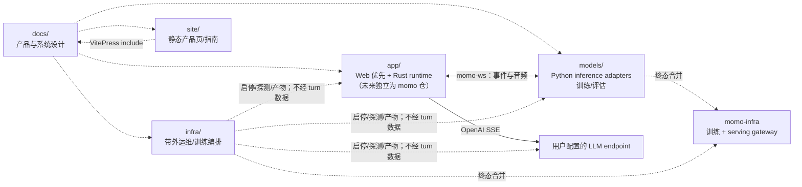

# momo 设计文档

**让桌面多一个，懂得回应的存在。**

momo 是一个有形象、有性格、有自己记忆的伙伴：她能听你说话，也懂得怎么陪你。这里从相处体验出发，用架构图和操作流程说明 momo 如何感知、回应与陪伴。

## 从体验进入设计

- **在场**：住在屏幕一角，注视、眨眼，回应你的触碰。
- **接话**：文字与语音自由切换，你插话时，她停下来听。
- **像人**：有人格、有情绪；自己管理长期记忆，随相处自进化。

[产品体验](./00-context/product.md) · [操作图谱](./01-architecture/workflows.md) · [开发进度](./06-management/github-project.md#工程状态)

## 仓库地图（协作期 monorepo → 终态拆分）

## 阅读顺序

1. [产品定义](./00-context/product.md)
2. [路线图](./00-context/roadmap.md)
3. [总体架构](./01-architecture/system.md)
4. [桌面宿主](./01-architecture/desktop.md)
5. [运行时](./01-architecture/runtime.md)
6. [通信协议](./01-architecture/protocol.md)
7. [操作路径图谱](./01-architecture/workflows.md)
8. [模块边界](./01-architecture/boundaries.md)
9. 配置规范：`01-architecture/config.md`（app 面 `MOMO_` env，仓内文档）

## 目录

| 目录 | 内容 |
|---|---|
| `00-context/` | 产品、路线、ADR、素材许可 |
| `01-architecture/` | 系统、桌面、运行时、协议、操作路径、边界、配置 |
| `02-repos/` | app 模块设计 |
| `03-features/` | Web 交互闭环、自管理记忆、扩展能力、工具、直播方向入口 |
| `04-tracks/` | persona 轨道 |
| `06-management/` | 工程状态与 GitHub Project 协作 |

> `models/` 与 `infra/` 侧文档（部署、降级、模型获取、训练、运维控制台等）随拆分迁往 **momo-infra** 仓，不在本仓维护。

## 设计不变量

- 产品支柱：**在场 / 接话 / 像人**；相处体验是中心，Web 为当前载体。
- `TurnCoordinator` 独占 turn；persona/连接、turn、animation 三套时钟独立。
- Stop 立即停本地播放与嘴型，同时并行取消上游；不等 ACK 才 cancel。
- `Speaking` 由实际 `playback.started` 触发；旧 stream 不得进入新 turn。
- infra 在 turn 数据路径外；静态网站不访问本地 API、密钥或麦克风。
- 平台能力不足时使用普通可见窗口与系统菜单 fallback。
- 上游库、Runtime Core、模型与素材各自核验许可；应用许可证不自动覆盖它们。

## 文档规则

- `docs/` 是产品与系统设计的单一来源，public guide 通过 include 呈现同一份内容。
- 图先说明组件、状态与操作关系，正文补充图中无法表达的约束。
- 使用小而聚焦的 Mermaid 图；用户操作写清 entry、decision、effect、terminal/retry/cancel。
- 不发明性能数据；历史实测标日期，未验证数据写“待实测”。
