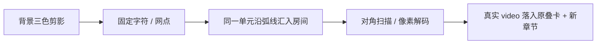

# 012 / 013：背景人物与像素演出修订

日期：2026-10-23。夜羽否决上一轮前景立绘、重复 hero 和过简转场后迭代。候选未发布，待用户 review。

## 参考与实际研究

- [ZipZipPipe 的原作合集](https://www.pixiv.net/artworks/148186519)：核对原站元数据与 17 页原图。Grok 的重点是明亮长发、黑金哥特轮廓与调皮表情的反差；不搬用冠饰、双马尾、翼、战斧。原设参考与影片作者的剪影处理分别记录。
- [world.execute(me)](https://www.bilibili.com/video/BV186pc65E68/)：使用独立的已登录 Playwright 从开头播放至片尾。无登录状态的首轮截图被弹窗遮挡，明确作废。重新核对全时间轴，并补看截图等待造成的 76–147 秒证据缺段；合并 103 张可见画面，采样最大间隔约 2.44 秒，片尾实际播放到结束。原片未下载、未进入产品。
- 阅读[作者源码](https://github.com/Nyankomintsu/world-execute-me-lyric-mv)，固定 commit `93ac63775ee58b33ff102167514f2603a48940cc`：`art.js` 三墨分版 / 一次取样，`ascii.js` 字符和网点构形，`transitions.js` 像素溶解与扫描，`post.js` 分层后处理，`engine.js` 确定时间轴，以及开机 / 独处 / 故障 / 片尾的对应场景。

| 原片时间 | 观察与转化 |
| --- | --- |
| 00:05–00:34 | 人物最早存在于界面后面；开场通过界面生成与焦点变化推进，借鉴背景层次，不复刻启动文案 |
| 00:53–01:04 | 方块化、历史轮廓与共享记忆的图形联动；特效表达内容状态，而非随意飘点 |
| 01:20–01:34 | 物体由字符组成，内部内容被拆开；借鉴字符属于同一图形、轮廓仍可识别的规则 |
| 02:03–02:10 | 人物成为固定网点，删去的消息化作碎片，之后用面部裁切转场；参考固定单元身份和暗部留白 |
| 02:47–03:17 | 大字作为人物窗口、墨版短暂错位、字符离开手部、窗口递归；只提炼裁切与重组，未照搬报错、色调或强闪烁 |
| 03:17–03:37 | 同一幅图收进一条图片消息，界面逆序卸载；借鉴“同一个对象收回真实界面”，避免截图交接跳变 |

原作图、视频截图、源码及研究表仅在忽略的 `.workbuddy/012-video-study-v2/`；没有第三方人物、歌词、音频或源码片段进入发布资源。

## 新候选

- C 为内置 image_gen 新建并修订的原创人物：非对称长卷发、黑脸、黑金哥特衣领与极少刻痕。生成不输入第三方人物图；[原图、提示词与校验](../docs/assets/mascot/README.md)可追溯。
- 网站中人物放大、裁切、低对比地压在正文后面；内部墨色保留，不再前景完整展示，也不再统一单色 mask。官网不携带已停用的 v1 WebP。
- 开场 h1 只出现一次；落位改为较小的“先从一句「你好」开始。”及实际对话说明，三语对应。README / 应用沿用的上一轮候选未在本轮重复替换或重打包，等待人物方向 review 后统一。

滚动是唯一形变时钟，固定单元可逆且停下不重采样；两次图像读回发生在载入时，绘制不持续空转。图片 / Canvas 故障、减少动态、SaveData 与窄屏保持完整静态内容；既有视频、导航和叠卡继续使用真实 DOM。

## 验证状态

- 生产构建通过；单元 **12/12**，最终完整浏览器 E2E **14/14**，`git diff --check` 通过。验证范围为 macOS 上的 Chromium；未把浏览器结果称作原生应用或硬件帧率测试。
- 实际图片在 1440×1000、1938×1280 检查开头、字符化、流转、像素显影和落位；另检查 801px 窄桌面的真实裁切。保留单个 video 与 Canvas，正反向相同进度的 Canvas 字节一致，重复滚动仍只有载入时的两次图像读回。
- 完整覆盖三语、键盘 / 鼠标 / 拖动、视频显式暂停与恢复、帮助及站内链接、图片 / Canvas 故障、路由释放、减少动态与 SaveData。窄屏仅验证已有官网回退，没有推进手机应用设计。
- 独立 code-review-excellence 找到并复核修复：旧 `#moments` 不再在缩放时抢回阅读位置；像素房间使用与 CSS `object-fit: cover` 一致的中心裁切。另复现并修复旧异步加载结果清空新 Canvas 的竞争。
- 最后的实际画面检查发现封面与已播放视频同时淡化会重影，改为不透明交接：进度 .69 时像素面 alpha 为 255，.70 时 DOM 图像完全不透明、Canvas 每个 alpha 均为 0，之后才显示视频运动。实际截图确认只有一个清晰的人物姿态。
- PNG / WebP 的 alpha，以及墨紫 / 暖白底上的可见合成逐像素一致；v1 官网副本已移除。研究文件和临时浏览器认证文件未进入 Git，临时认证文件已清除，独立研究浏览器已关闭。

最终证据在 `.workbuddy/012-site-v2/evidence/final/`。测试专用 4182 服务退出；保留一份 4176 候选预览供夜羽体验。构建后重启该预览，避免 VitePress 进程保留旧入口资源映射。用户原浏览器窗口和实验室机器未作为本轮最终验证环境。

## 验收范围

2026-10-23，夜羽认可新版首页开场，要求先保留并推送这一版。该确认仅针对开场效果；012 继续推进后续章节的滚动演出、同级全局导航与帮助页设计，不将整项计划提前归档。
